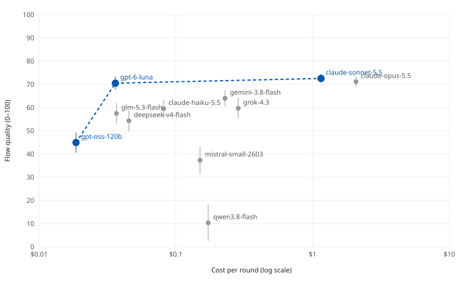

# Live-flow eval results (2026-11-19)

21 cases from one real round × 11 models × 2 repeats = 462 flows, graded blind by Claude Sonnet 5.5;
GPT-6.2 Sol re-graded 80 of them. Total cost $9.55. Cost per round = cost per call × 60 live-flow calls.
Raw data (student speech) stays in `evals/.data/` and is never committed. Re-run: see README.md.

| Model | Quality (95% CI) | Valid replies | $ / round | p50 s | On the frontier |
|---|---|---|---|---|---|
| openai/gpt-6-luna | **70.5** (67.6–73.4) | 100% | **$0.036** | 8.4 | ★ |
| anthropic/claude-sonnet-5.5 | 72.5 (70.7–74.3) | 100% | $1.15 | 9.6 | ★ |
| anthropic/claude-opus-5.5 (old default) | 71.1 (68.8–73.4) | 100% | $2.08 | 13.5 | |
| google/gemini-3.8-flash | 64.0 (60.4–67.6) | 100% | $0.23 | 5.5 | |
| x-ai/grok-4.3 | 59.7 (55.3–64.0) | 100% | $0.29 | 11.2 | |
| anthropic/claude-haiku-5.5 (Claude default) | 59.5 (55.8–63.3) | 100% | $0.081 | 10.2 | |
| z-ai/glm-5.3-flash | 57.5 (53.0–62.0) | 100% | $0.037 | 5.3 | |
| deepseek/deepseek-v4-flash | 54.3 (49.7–58.9) | 95% | $0.045 | 30.7 | |
| openai/gpt-oss-120b | 44.9 (40.6–49.3) | 98% | $0.019 | 4.4 | ★ (too weak to use) |
| mistralai/mistral-small-2603 | 37.3 (31.3–43.3) | 83% | $0.15 | 16.9 | |
| qwen/qwen3.8-flash | 10.3 (2.5–18.1) | 14% | $0.17 | 111.6 | (cut off at the 6k cap: it spends it thinking) |

## What it means

- **GPT-6 Luna is the clear value pick:** within 2 points of Sonnet and Opus, at 1/30 of Sonnet's cost and 1/57 of Opus's.
- **Haiku 5.5 trails** (59.5), mostly on *faithful* (1.40 of 3: invented or wrong authors/numbers). Both judges agree.
- **Opus is not better than Sonnet** for the live flow, at nearly twice the cost.
- **Judges:** Sol is stricter (quality about 18 points lower on average) but ranks the models in nearly the same order, with Luna first. The Sonnet judge did not favor Claude models (it ranked Luna above Haiku and level with Sonnet/Opus).
- **Every model is weakest on faithful.** The prompt asks for three detail levels at once; plan step B3 (one level per pass) and a prompt pass aimed at faithfulness are the next quality levers.

## Limits

- One round, one topic. Gaps under about 5 points are not reliable. Add 2–3 more rounds before tuning small differences.
- The hand check (10 flows in `evals/.data/live-flow/hand-grade.md`) is not done yet. Until it is, the judge's scale is unconfirmed.
